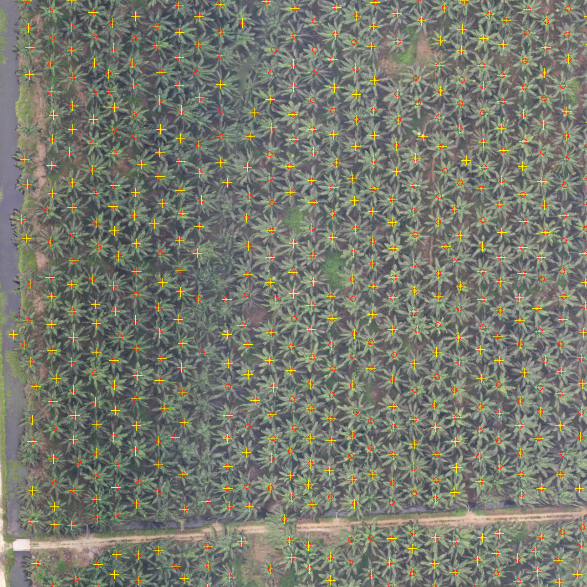
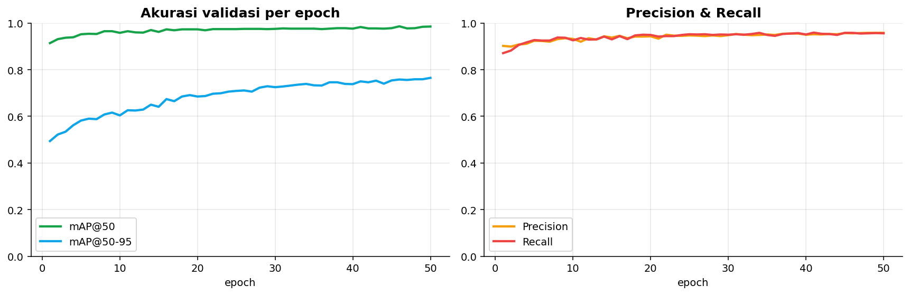

# Palm Tree Counting — YOLOv8 + Orthomosaic GIS Pipeline

A complete pipeline for counting oil palm trees from aerial orthophotos:
**lossless mosaic -> YOLOv8 inference on Google Colab GPU -> georeferenced tree
points -> river setback analysis in QGIS**.

Every number below comes from real production data (5 orthophotos across
UTM 47N/48S, 310+ hectares), not from sample data.

---

## Main results

| Area | Valid area | Trees | Density | Median conf |
|---|---|---|---|---|
| 47N mosaic (4 orthos merged) | 310.8 ha | **24,966** | **80.3 /ha** | 0.697 |
| ORTO 47N (per file) | 138.1 ha | 12,864 | 93.1 /ha | — |
| PMBN1 47N | 63.5 ha | 6,008 | 94.6 /ha | 0.755 |
| PMBN3 47N | 48.2 ha | 399 | 8.3 /ha | 0.633 |
| PMBN ORTO2 (UTM 48S) | 90.2 ha | 8,040 | 89.1 /ha | 0.704 |

**Model accuracy** (YOLOv8n fine-tuned on Roboflow Universe v15, 2,730 images /
180,170 boxes, 280-image validation split):

| Metric | Value |
|---|---|
| mAP@50 | **0.977** |
| Precision / Recall | 0.955 / 0.955 |
| mAP@50-95 | 0.745 |
| **Tree count bias** (production test) | **±8 %** |
| Recall / Precision @ IoU 0.5 | 84.6 % / 78.5 % (F1 0.814) |
| Agreement with algorithmic digitising | 92 % |

**River setback analysis** (3 PMBN orthos, 500 m segment shapefile + 5 m river
width polygons):

| Item | Value |
|---|---|
| Trees inside the 500 m setback shapefile | **2,253** of 6,495 (PMBN1 2,111 · PMBN2 15 · PMBN3 127) |
| Trees inside the 5 m river polygons | **100** (segments 13–22) |
| Setback raster clip area | 20.8 / 5.3 / 20.0 ha (PMBN1/2/3) |
| River raster clip area | 1.05 / 0.27 / 1.02 ha (PMBN1/2/3) |

Cross-run consistency (per-ortho detection vs detection on the merged mosaic):

| Source | per-ortho | on mosaic | delta |
|---|---|---|---|
| ORTO 47N | 93.1/ha | 93.0/ha | −0.1 % |
| PMBN1 | 94.6/ha | 98.8/ha | +4.4 % |
| PMBN2 | 89.1/ha | 86.9/ha | −2.5 % |

---

## Problems this solves

**Double counting from overlapping orthos.** Four orthos overlap by 30.4 ha.
Detecting per file counts trees in the overlap twice. The fix: merge everything
into one lossless mosaic (DEFLATE ZLEVEL 9 + PREDICTOR 2, grid aligned to the
finest pixels, 9 overview levels — 1.66 GB for 3.7 Gpx), then run detection
once. Cross-check: the count drops from 27,399 to 24,966 (a difference of
2,433) while the independent estimate from the overlap area is ±2.430.
**They match.**

**Mosaic sharpness.** The output grid was not aligned to the source pixels, so
the finest source (PMBN2) was blurred by bilinear resampling as well. After
locking the grid to the PMBN2 pixels and switching coarse-source resampling to
cubic: PMBN2 became **pixel-identical** (correlation 1.0000, difference 0), and
the other sources rose to 0.87–0.95.

**Resolution vs model GSD.** The model was trained at 0.155 m; the mosaic is
0.071 m. Strips are resampled to the model GSD before inference so crowns span
the same number of pixels as during training.

---

## Architecture

```
orthophoto (.tif, EPSG:32647/32648)
   |  merge_orto.py            -> lossless mosaic + pixel-aligned grid + overviews
   |  prep_model_gsd.py        -> resample to model GSD (0.155 m)
   |  split_mosaic_strips.py   -> cut into strips (small enough to upload to Colab)
   v
Google Colab (T4 GPU)
   |  _colab_detect.py         -> sliding window 640, overlap 96, conf 0.25, IoU 0.7
   |  5 m min-distance dedupe per strip -> CSV per strip (x, y, conf, box_w, box_h)
   v
new_orto_report.py             -> global dedupe -> GPKG/GeoJSON/CSV + QA render
analisis_sempadan_sungai.py    -> count points inside 500 m setback & 5 m river polygons
validate_count.py              -> validation against the Roboflow sample (IoU matching)
```

What makes the counting accurate:

- **5 m minimum-distance dedupe** — confidence NMS alone is not enough in a
  dense plantation; two boxes can mark the same crown.
- **Global dedupe after strips are merged** — per-strip filtering leaks at strip
  boundaries (the crown centre shifts by a few metres).
- **Alpha band** — transparent areas between corridors are skipped
  automatically, so no empty points are produced.

---

## Repository layout

| Path | Contents |
|---|---|
| `code/` | the whole pipeline (mosaic, detection, validation, setback analysis) |
| `colab/colab_oilpalm.ipynb` | Colab notebook for training + inference |
| `docs/` | technical report, QGIS guide, result summaries (JSON), training curves |
| `docs/images/` | detection output and QA visuals |
| `sample/` | sample tree point output (CSV) |

## Running it

```bash
pip install -r requirements.txt

# 1. merge the orthos
python code/merge_orto.py --build

# 2. match the model GSD, cut into strips
python code/prep_model_gsd.py
python code/split_mosaic_strips.py

# 3. inference on Colab (GPU) -> CSV per strip, then merge + render QA
python code/new_orto_report.py --dir output/mosaik --name mosaik47n \
    --parts strip1 strip2 ... --raster intermediates/mosaik_155/mosaik47n_155.tif

# 4. setback / river analysis
python code/analisis_sempadan_sungai.py
```

Per-run numbers are in `docs/REPORT.md` and `docs/ringkasan_*.json`.

---

<p align="center"> </p>
